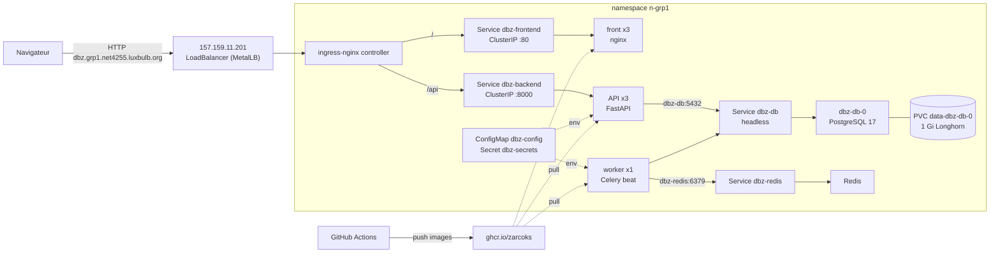

# Déployer Dragon Ball Park sur Kubernetes

Ce dossier déploie toute l'application (front, API, worker, Redis, PostgreSQL) sur le
cluster du cours, dans le namespace `n-grp1`. C'est la traduction de
[`docker-compose.yml`](../../docker-compose.yml) en objets Kubernetes.

**État :** déployé et testé de bout en bout le 06/11/2026.
Adresse : http://dbz.grp1.net4255.luxbulb.org/ (l'entrée DNS est à demander au prof, voir § 6).

## 1. De docker-compose à Kubernetes

| Compose (`docker-compose.yml`) | Kubernetes (ce dossier) | Pourquoi ce choix |
|---|---|---|
| `build: ./backend`, `build: ./frontend` | Images `ghcr.io/zarcoks/dbz-park-{backend,frontend}` construites par GitHub Actions | Le cluster ne construit rien : il télécharge des images depuis un registre. |
| `.env` | ConfigMap `dbz-config` + Secret `dbz-secrets` | La config lisible dans git, les secrets seulement dans le cluster. |
| `db` + volume `postgres_data` | StatefulSet `dbz-db` (1 réplica) + PVC 1 Gi (Longhorn) + Service **headless** | Une base a un état : identité stable (`dbz-db-0`) et disque qui survit au Pod. |
| `redis` | Deployment `dbz-redis` + Service ClusterIP | Simple broker, rien à persister. |
| `backend` | Deployment `dbz-backend` (**3 réplicas**) + Service ClusterIP | L'API est sans état (JWT) : on peut la dupliquer. |
| `worker` | Deployment `dbz-worker` (**1 réplica**, stratégie `Recreate`) | Celery beat doit tourner une seule fois, sinon les visiteurs sont appelés en double. |
| `frontend` (nginx + proxy `/api`) | Deployment `dbz-frontend` (3 réplicas) + Service ClusterIP | nginx ne sert plus que les fichiers statiques. |
| port `8080` publié + proxy nginx | **Ingress** `dbz-park` | `/api` → API, le reste → front. C'est l'ingress-nginx du cluster qui joue le rôle du proxy. |
| `depends_on: service_healthy` | `initContainer` `wait-db` + `readinessProbe` | L'API attend que Postgres réponde. Le trafic ne va qu'aux Pods prêts. |
| `healthcheck` | `readinessProbe` / `livenessProbe` | `/api/health/` pour l'API, `pg_isready` pour la base, `redis-cli ping` pour Redis. |

Chaque conteneur : requests `100m` CPU / `100Mi`, limits `200m` CPU / `200Mi` (comme au défi 2).

## 2. Schéma



## 3. Les fichiers

Numérotés dans l'ordre où ils dépendent les uns des autres.

| Fichier | Contenu |
|---|---|
| `00-config.yaml` | ConfigMap `dbz-config` : hôte de la base, Redis, fuseau, CORS… |
| `10-db.yaml` | Service headless + StatefulSet PostgreSQL + volumeClaimTemplate |
| `20-redis.yaml` | Service + Deployment Redis |
| `30-backend.yaml` | Service + Deployment de l'API (initContainer `wait-db`, sondes) |
| `40-worker.yaml` | Deployment du worker Celery |
| `50-frontend.yaml` | ConfigMap nginx (sans proxy `/api`) + Service + Deployment du front |
| `60-ingress.yaml` | Ingress : `/api` → API, `/` → front |
| `smoke_test.py` | Test de bout en bout par l'Ingress, même sans DNS |

En dehors de ce dossier :
- `.github/workflows/images.yml` : build et push des 2 images en `linux/amd64` (les nœuds sont en x86_64) à chaque push sur `main` qui touche `backend/` ou `frontend/`. Tags : `latest` et le SHA du commit.
- `backend/alembic/env.py` : verrou Postgres (`pg_advisory_xact_lock`) autour des migrations, voir § 5.

## 4. Les étapes, dans l'ordre

Prérequis : `kubectl` configuré sur le cluster (voir `../defi1/commandes.sh`), namespace `n-grp1` par défaut.

```bash
# 1. Images : pousser sur main suffit, la CI les publie sur GHCR.
#    Le repo est public, donc les packages aussi : pas besoin d'imagePullSecret.

# 2. Secrets : générés au hasard, créés directement dans le cluster, jamais commités.
gen(){ python3 -c "import secrets;print(secrets.token_urlsafe($1))"; }
umask 077; gen 12 > ~/.dbz-admin-password          # mot de passe du compte admin
kubectl create secret generic dbz-secrets \
  --from-literal=POSTGRES_PASSWORD=$(gen 24) \
  --from-literal=JWT_SECRET=$(gen 48) \
  --from-literal=ADMIN_PASSWORD=$(cat ~/.dbz-admin-password)

# 3. Tout le reste.
kubectl apply -f kub/app/

# 4. Attendre que tout soit prêt.
kubectl rollout status statefulset/dbz-db
for d in dbz-redis dbz-backend dbz-worker dbz-frontend; do kubectl rollout status deployment/$d; done
kubectl get pods,svc,pvc,ingress -l app.kubernetes.io/part-of=dbz-park -o wide

# 5. Tester par l'Ingress (marche avant même que le DNS existe).
python3 kub/app/smoke_test.py ~/.dbz-admin-password
```

Résultat attendu du test :
```
front /           200 Dragon Ball Park
SPA /connexion    200
api health        200 {"status":"ok"}
login admin       200 {'id': 1, 'username': 'admin', 'is_staff': True}
attractions       200 ['La Salle du Temps', 'Le Vaisseau de Freezer', 'Le Palais de Kaio', 'La Tour de Karin']
```

Vérifier la base (1 admin, 30 billets, 4 attractions, schéma à jour) :
```bash
echo 'select count(*) from "user"; select count(*) from ticket; select version_num from alembic_version;' \
  | kubectl exec -i dbz-db-0 -- psql -U dbz_park -d dbz_park
```

## 5. Les pièges rencontrés

1. **Migrations en parallèle.** L'image lance `alembic upgrade head` au démarrage. Avec
   3 réplicas, 3 migrations partaient en même temps, et `kubectl create job` n'est pas
   autorisé sur ce namespace. Solution : un verrou consultatif Postgres dans
   `alembic/env.py`. Une instance migre, les autres attendent puis voient le schéma à
   jour. Le bootstrap (admin, billets, attractions) avait déjà son propre verrou :
   vérifié, il n'y a aucun doublon.
2. **La base pas encore prête.** Un Service headless ne publie dans le DNS que les Pods
   *prêts* : au premier démarrage `dbz-db` ne résolvait pas encore, et l'API plantait
   (`Name or service not known`, 2 redémarrages). Solution : l'initContainer `wait-db`
   (`until pg_isready -h dbz-db; do sleep 2; done`).
3. **nginx du front.** Le `nginx.conf` de l'image fait suivre `/api` vers l'hôte
   `backend`. Ce nom n'existe pas ici, et nginx refuse de démarrer sur un hôte
   inconnu. Comme l'Ingress route déjà `/api`, une ConfigMap remplace ce fichier par
   une version qui ne sert que les fichiers. L'image reste la même pour compose.
4. **`PGDATA`.** La racine d'un volume Longhorn contient `lost+found` : Postgres refuse
   un dossier non vide. On pointe donc `PGDATA` vers un sous-dossier.
5. **Ingress sans adresse.** Avec `ingressClassName: nginx`, l'Ingress est resté sans
   `ADDRESS` (nous n'avons pas le droit de lister les IngressClass). Sans le champ, la
   classe par défaut du cluster l'a pris en charge : adresse `157.159.11.201`.
6. **Droits limités.** Pas de droit de lire `endpointslices`, `events`, `jobs`,
   `networkpolicies`. Il faut vérifier autrement : sondes, logs, `kubectl exec`, test
   par l'Ingress.

## 6. Ce qu'il reste à faire

- **DNS :** demander au prof l'entrée `dbz.grp1.net4255.luxbulb.org → 157.159.11.201`.
- **HTTPS :** ajouter une section `tls:` à l'Ingress quand le cluster fournit un certificat (cert-manager ou certificat du prof).
- **Suite des défis :** charte Helm (défi 6), HPA (défi 9), NetworkPolicy (défi 11, interdite pour nous pour l'instant).

## 7. Mettre à jour l'application

```bash
git push origin main                              # la CI republie les images :latest
kubectl rollout restart deployment/dbz-backend deployment/dbz-worker deployment/dbz-frontend
kubectl rollout status deployment/dbz-backend     # rolling update, sans coupure
```
`imagePullPolicy: Always` force le téléchargement de la nouvelle `:latest`. Pour une
version figée, remplacer `:latest` par le SHA du commit (tag publié par la CI).

## 8. Tout supprimer (sans perdre les données)

```bash
kubectl delete -f kub/app/            # le PVC data-dbz-db-0 est conservé
kubectl delete secret dbz-secrets
# kubectl delete pvc data-dbz-db-0    # seulement pour effacer la base pour de bon
```
