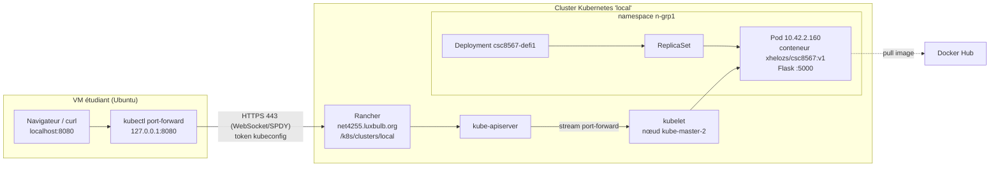

# Défi 1 - Schéma d'infrastructure

Chemin d'une requête : navigateur → `kubectl port-forward` (localhost:8080) → Rancher (proxy API, HTTPS) → kube-apiserver → kubelet du nœud → conteneur du Pod (port 5000).
Aucun Service n'est utilisé : le Pod n'est joignable que via ce tunnel.
