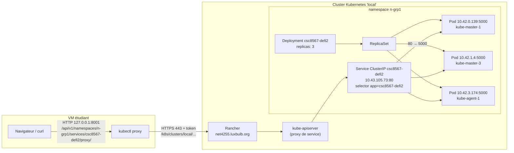

# Défi 2 - Schéma d'infrastructure

Chaque Pod : requests 100m CPU / 100Mi, limits 200m CPU / 200Mi.
Réseau Pods : 10.42.0.0/16 (une plage /24 par nœud). Réseau Services : 10.43.0.0/16.
Le ClusterIP n'existe que dans le cluster (règles kube-proxy sur chaque nœud) : depuis la VM on passe par l'API server.
